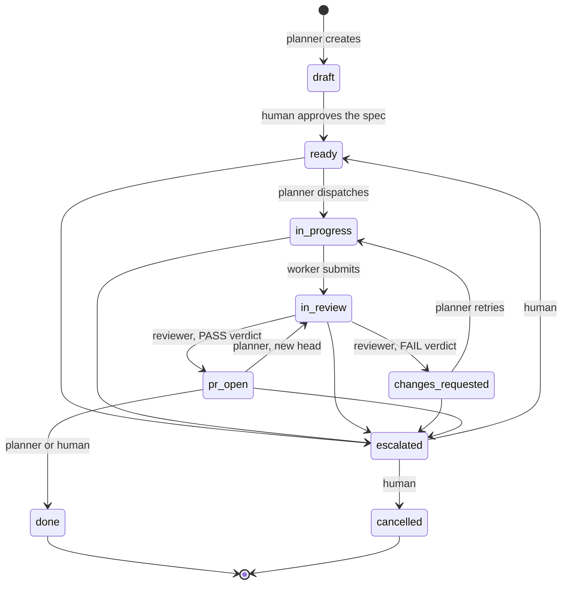

# agent-gates

[](https://github.com/MarcPaquet/agent-gates/actions/workflows/tests.yml)

Coding agents grade their own work, edit test assertions until they pass, and merge if nothing stops them. This kit
separates who plans, who builds and who reviews; makes the reviewer's verdict a file the state machine requires
before a task's pull request may be recorded as open; and keeps the three decisions that matter — spec, merge, escalation — behind gates
only a human at a real terminal can pass.

What each gate stops, and what it does not, is stated under [Honest limits](#honest-limits).

The core is plain Python 3.11 or later with no dependencies: a state machine (`gates/machine.py`), a JSON store
(`gates/store.py`), the agents' command line (`gates/cli.py`) and the human's command (`gates/approve.py`). It is
tool-agnostic. One harness adapter, for Claude Code, lives in [`.claude/`](.claude/README.md) and is live in this
repository.

## The loop



The five unlabelled arrows into `escalated` are made by the planner, the worker or the reviewer, with a reason,
what was tried, the options and a recommendation.

## Roles and the human's decisions

Each role is one screen of harness-neutral prose in `roles/`. The roles are separated by the harness (here, the
agent files in `.claude/agents/` and the guard hook), not by the library: the command line trusts the `--actor` an
agent passes, except `human`.

| Role | Does | Does not | Prose |
|---|---|---|---|
| planner | Writes the spec and the contract, creates the task (`new` is planner-only), dispatches it, retries it once after a failed review, sends it back to review after a push to its pull request, closes it after the merge, escalates | Build, review, write a verdict, run `gates/approve.py` | [`roles/planner.md`](roles/planner.md) |
| worker | Builds inside the task's `owns` globs, writes progress notes, fills the contract's Concerns table, submits for review, escalates | Review, merge, edit a test to make it pass, run `gates/approve.py` | [`roles/worker.md`](roles/worker.md) |
| reviewer | Runs the contract's checks, writes a new verdict file each review cycle, records FAIL or PASS (with the pull request number), escalates | Edit product code, review its own work, run `gates/approve.py` | [`roles/reviewer.md`](roles/reviewer.md) |
| human | Approves the spec, resolves an escalation (back to `ready`, or `cancelled`), gives the go to merge a pull request at its head, may close a merged task | — | `gates/approve.py` |

In this repository the agent files set the planner to Opus at high effort, the worker to Sonnet at low effort, and
the reviewer to Opus at high effort with no Edit tool.

The human's command, from the repository root:

```
python gates/approve.py T-001 ready        # approve the spec (from draft), or resolve an escalation
python gates/approve.py T-001 cancelled    # resolve an escalation by cancelling the task
python gates/approve.py T-001 done         # close a task whose pull request was merged
python gates/approve.py T-001 --merge      # approve the open pull request for merge at its current head
```

Every form takes `--comment TEXT`, recorded in the history.

**The merge go.** `approve.py T-001 --merge` is refused unless the task is in `pr_open` with a pull request number
recorded. It reads the pull request's head with `gh pr view N --json headRefOid`, then records it as
`merge_approved_head`, provided the task did not change while `gh` ran. It prints the one merge command an agent
may then run, `gh pr merge N --squash --match-head-commit <SHA>`. The adapter's guard denies any `gh pr merge`
without `--match-head-commit <SHA>` (the method flags `--squash`, `--merge` and `--rebase`, and `--delete-branch`
and `--auto`, are allowed beside it), and denies it unless a task in `pr_open` has that pull request and that head
approved. The go is not a transition: the task stays in `pr_open`. A move back to `in_review` after a push clears it.

## The state machine

Every rule is in [`gates/machine.py`](gates/machine.py), as pure functions over the store: no file, clock,
environment or process access. `gates/cli.py` reads the files a rule needs and passes them in as evidence.

### States

| State | Meaning |
|---|---|
| `draft` | Created by the planner. The spec and contract wait for the human's approval. |
| `ready` | Spec approved. The task may be dispatched. |
| `in_progress` | Dispatched. The worker builds inside the task's `owns` globs. |
| `in_review` | Submitted. The reviewer checks the work against the contract. |
| `changes_requested` | The review failed. The planner may retry it once; any agent may escalate it. |
| `pr_open` | The review passed and the pull request number is recorded. The merge go and the merge happen here. |
| `escalated` | An agent stopped and asked the human. The task keeps its `owns` globs. |
| `done` | Terminal. Closed after the merge; nothing checks that the merge happened. |
| `cancelled` | Terminal. The human cancelled an escalated task. |

No transition leaves a terminal state. A task holds its `owns` globs in `in_progress`, `in_review`,
`changes_requested`, `pr_open` and `escalated`: no other task whose globs overlap may be dispatched meanwhile.

### Transitions

| From | To | Who | Refused unless |
|---|---|---|---|
| `draft` | `ready` | human | The actor is the human, which only `gates/approve.py` can be. |
| `ready` | `in_progress` | planner | The contract file exists, the task owns at least one glob, and no dispatched task's globs overlap them. Records who the task went to and when. |
| `in_progress` | `in_review` | worker | The contract has a Concerns table with at least one row and every row's Status is `addressed`, `not applicable` or `deferred`; the progress log has an entry written at or after the dispatch. |
| `in_review` | `changes_requested` | reviewer | `--verdict` names an existing file with exactly one `Overall: FAIL` line, not recorded for an earlier review. Adds one to `review_cycles`. |
| `in_review` | `pr_open` | reviewer | `--verdict` names an existing file with exactly one `Overall: PASS` line, not recorded for an earlier review; `--pr N` is a positive integer. |
| `changes_requested` | `in_progress` | planner | `review_cycles` is below 2, then the same checks as the first dispatch. After the second failed review the retry is refused and the planner escalates instead. Resets the dispatch time, so the worker must write a new note. |
| `pr_open` | `in_review` | planner | `--head` is a full 40-character commit SHA (the pull request's new head). Clears the merge go; spends no review cycle. |
| `pr_open` | `done` | planner, human | Nothing: the command line does not check that the pull request was merged. |
| `ready` | `escalated` | planner, worker, reviewer | `--reason`, `--tried`, `--options` and `--recommends` are all given and not empty. |
| `in_progress` | `escalated` | planner, worker, reviewer | As above. |
| `in_review` | `escalated` | planner, worker, reviewer | As above. |
| `changes_requested` | `escalated` | planner, worker, reviewer | As above. |
| `pr_open` | `escalated` | planner, worker, reviewer | As above. The four fields are stored in the task's `escalation`, with the state it came from, the actor and the time. |
| `escalated` | `ready` | human | The actor is the human. Clears `escalation`. |
| `escalated` | `cancelled` | human | The actor is the human. Clears `escalation`. |

Every move is checked in the same order, so the refusal is deterministic: unknown task, unknown state, terminal
state, no such transition, wrong actor, then the guards of the row in the order written above.

### Refusals

Every refusal message of the state machine lives in `machine.REFUSALS`; the adapter's guard has its own (see
[`.claude/README.md`](.claude/README.md)). `gates/cli.py` and `gates/approve.py` print it on
standard error as `refused: <message>` and exit with status 1; a usage error exits with status 2. The placeholders
in braces are filled with the task's values. The store's own errors (the lock held by another command for more
than 5 seconds, an unreadable store file, an invalid new task) come from `gates/store.py` with their own messages.

| Rule | Message |
|---|---|
| `unknown_task` | `` there is no task {task} in the store. Run `python gates/cli.py board` to list the tasks. `` |
| `unknown_state` | `` '{state}' is not a state. The states are: {states}. `` |
| `terminal_state` | `` {task} is {state}, a terminal state, and no transition leaves it. If more work is needed, create a new task. `` |
| `no_such_transition` | `` {task} cannot go from {from_state} to {to_state}. The legal next states from {from_state} are: {targets}. `` |
| `human_only` | `` {task}: {from_state} -> {to_state} is a human decision and {actor} cannot make it. The human runs `python gates/approve.py {task} {to_state}` at a terminal. `` |
| `wrong_actor` | `` {task}: {from_state} -> {to_state} is made by {allowed}, not by {actor}. `` |
| `contract_missing` | `` {task} cannot be dispatched: its contract file {contract} does not exist. The planner writes the contract before dispatching. `` |
| `owns_empty` | `` {task} cannot be dispatched: it owns no paths. Give the task its `owns` globs so overlapping work can be detected. `` |
| `owns_overlap` | `` {task} cannot be dispatched: its `owns` globs overlap with {others}, still dispatched. Wait until they are done or cancelled, or narrow the globs so the tasks touch different paths. `` |
| `review_cycle_limit` | `` {task} has failed review {cycles} times, the limit is {limit}, so it may not be retried. The planner escalates it to the human instead: `python gates/cli.py transition {task} escalated --actor planner --reason ... --tried ... --options ... --recommends ...`. `` |
| `concerns_missing` | `` {task} cannot go to review: its contract {contract} has no Concerns table with at least one row. Add a `## Concerns` section with a `Concern \| Status \| Note` table and one row per concern. `` |
| `concerns_unfilled` | `` {task} cannot go to review: these concerns have no status: {concerns}. Set each Status to addressed, not applicable or deferred. `` |
| `no_progress_note` | `` {task} cannot go to review: no progress note was written since the dispatch at {dispatched_at}. Write one with `python gates/cli.py note {task} --actor worker TEXT`. `` |
| `verdict_path_missing` | `` {task}: {to_state} records a review, which needs the reviewer's verdict file. Pass --verdict PATH. `` |
| `verdict_file_missing` | `` {task}: the verdict file {path} does not exist. The reviewer writes it before recording the review. `` |
| `verdict_overall_missing` | `` {task}: the verdict file {path} has no single `Overall: PASS` or `Overall: FAIL` line. Write exactly one. `` |
| `verdict_overall_mismatch` | `` {task}: the verdict file {path} says `Overall: {found}`, but moving to {to_state} needs `Overall: {expected}`. `` |
| `verdict_reused` | `` {task}: the verdict file {path} was already recorded for an earlier review. Each review writes a new verdict file. `` |
| `pr_missing` | `` {task}: moving to pr_open needs the pull request number. Pass --pr N with a positive integer. `` |
| `head_invalid` | `` {task}: '{head}' is not a commit SHA. Pass --head with the full 40-character lowercase hexadecimal SHA of the pull request head. `` |
| `escalation_incomplete` | `` {task}: an escalation needs --reason, --tried, --options and --recommends, so the human can decide without asking. Missing: {missing}. `` |
| `merge_wrong_state` | `` {task} is {state}. A merge can only be approved while its pull request is open (pr_open). `` |
| `merge_no_pr` | `` {task} has no pull request number recorded, so there is nothing to approve for merge. `` |
| `human_actor_in_cli` | `` --actor human is refused: an agent cannot act as the human. Human decisions are made with `python gates/approve.py` at a terminal. `` |
| `agent_environment` | `` approve.py is the human's command and refuses to run in an agent session ({variable} is set). Run it yourself at a terminal. `` |
| `not_interactive` | `` approve.py needs an interactive terminal and its standard input is not one. Run it yourself at a terminal. `` |
| `pr_head_unavailable` | `` could not read the head commit of pull request #{pr} with gh: {detail} `` |
| `pr_head_invalid` | `` gh returned '{value}' as the head of pull request #{pr}, which is not a 40-character commit SHA. `` |
| `merge_state_changed` | `` {task} changed while its pull request head was being read (it is no longer as it was when the approval began). Run the merge approval again. `` |
| `new_planner_only` | `` only the planner creates tasks, not {actor}. Ask the planner to run `python gates/cli.py new --actor planner ...`. `` |
| `path_outside_root` | `` the path {path} is outside the project root {root}. Give a path inside the project, relative to the directory that holds the store. `` |
| `note_empty` | `` {task}: the note is empty. Write what was done, what is left and what is uncertain. `` |
| `note_heading` | `` {task}: the note contains a line starting with '## ', which would read as a new progress entry. Use '###' or plain text. `` |
| `file_unreadable` | `` the file {path} cannot be read ({detail}). Check that it is a readable file inside the project. `` |

A test, `gates/tests/test_readme.py`, keeps the three tables above equal to `machine.STATES`,
`machine.TRANSITIONS` and `machine.REFUSALS`.

## The agents' command line

`gates/cli.py` has seven commands; each writing command takes `--actor`.

```
python gates/cli.py new --actor planner --title T --contract contracts/T-002.md --owns 'src/**' [--id T-002]
python gates/cli.py dispatch T-002 --actor planner [--to worker]
python gates/cli.py note T-002 --actor worker "what was done, what is left"
python gates/cli.py transition T-002 in_review --actor worker
python gates/cli.py transition T-002 pr_open --actor reviewer --verdict reviews/T-002-verdict-c1.md --pr 7
python gates/cli.py transition T-002 escalated --actor worker --reason R --tried T --options O --recommends X
python gates/cli.py show T-002
python gates/cli.py board
python gates/cli.py history T-002
```

- `--actor human` is refused: the human's decisions are made with `gates/approve.py` only.
- `new` is refused for any actor but the planner.
- Contract and verdict paths are relative to the project root (the folder that holds `gates.json`) and refused if
  they lead outside it.
- The contract, verdict and progress parsers ignore lines inside fenced code blocks, so a quoted example is never
  read as the real thing. A Concerns table with no rows counts as missing.
- A note may not contain a line starting with `## `, which would read as a new progress entry.

**The store** is one JSON file, `gates.json`, committed, so `history T-001` works from a clone. A task has these
keys, in this order: `id`, `title`, `state`, `contract`, `owns`, `dispatched_to`, `dispatched_at`, `pr`,
`review_cycles`, `verdicts`, `merge_approved_head`, `merge_approved_at`, `escalation`, `history`. `escalation` is
null, or holds the four escalation fields with the state the task came from, the actor and the time. Every command
that writes the store holds an exclusive lock on `gates.json.lock` from reading the store to writing it back, and
writes it atomically (temp file, fsync, rename). The lock uses `fcntl`, so the kit runs on POSIX systems such as macOS and Linux, not on Windows.

## The walls

Three walls keep an agent from running `gates/approve.py` as the human. They are stated in the module docstring of
[`gates/approve.py`](gates/approve.py):

1. **The harness's deny rule and hook** (the Claude Code adapter in `.claude/`) refuse the command before it runs.
   They live outside the module.
2. **The agent-variable check.** The command refuses to run when a variable in `AGENT_ENV_VARS` is set, as a
   coding-agent harness does in the shells it runs. The list is `("CLAUDECODE",)`; extend it for each harness.
3. **The terminal check.** The command refuses to run when its standard input is not an interactive terminal, as
   it is not for a command an agent runs through a tool call.

What walls 2 and 3 do not prove: a process that clears the variable and allocates a pseudo-terminal passes both.
Wall 1 is what stops that, and the human's review of what an agent ran is the last.

The same guard hook also denies writing the store, a progress log or a recorded verdict by hand; a push to `main`, and a
merge, rebase or pull while `main` is checked out; `gh pr merge` without a recorded go for that pull request and head; and any call in
bypassPermissions mode. Its rules, its allowlist and its own limits are in [`.claude/README.md`](.claude/README.md).

## Try it

From a clone, with Python 3.11 or later and nothing to install, run these three commands at the repository root
against the committed store.

```
$ python gates/cli.py board
ID     STATE  OWNER   CYCLES  PR   TITLE
T-001  done   worker  1       #11  Markdown link checker (example app)
```

```
$ python gates/cli.py history T-001
T-001  Markdown link checker (example app)
  2026-11-02T19:16:08Z  created -> draft                  planner   created
  2026-11-02T23:32:40Z  draft -> ready                    human     spec approved
  2026-11-03T15:48:00Z  ready -> in_progress              planner   dispatched to worker
  2026-11-03T16:00:13Z  in_progress -> in_review          worker    submitted for review
  2026-11-03T16:05:35Z  in_review -> changes_requested    reviewer  review failed: reviews/T-001-verdict-c1.md [verdict reviews/T-001-verdict-c1.md]
  2026-11-03T16:06:10Z  changes_requested -> in_progress  planner   dispatched again after a failed review
  2026-11-03T16:08:53Z  in_progress -> in_review          worker    submitted for review
  2026-11-03T16:14:46Z  in_review -> pr_open              reviewer  review passed: reviews/T-001-verdict-c2.md, pull request #11 [verdict reviews/T-001-verdict-c2.md, pr 11]
  2026-11-03T16:26:08Z  pr_open -> done                   human     merged in the GitHub UI without the merge-approval step
```

```
$ python gates/cli.py transition T-001 in_progress --actor worker
refused: T-001 is done, a terminal state, and no transition leaves it. If more work is needed, create a new task.
```

The third command exits with status 1 and leaves `gates.json` unchanged: `done` is terminal.

## The example run

T-001 is the kit run on itself: a Markdown link checker ([spec](example/linkcheck/SPEC.md),
[contract](contracts/T-001.md)), built in `example/linkcheck/` through the gate and merged into this repository.
The store, the [progress log](progress/T-001.md) and the two verdicts are committed as the run wrote them. The
worker ran as Sonnet at low effort, each reviewer as Opus at high effort.

1. The planner wrote the spec and the contract and created the task in `draft`, owning `example/linkcheck/**`.
   The human approved the spec with `approve.py T-001 ready`.
2. The planner dispatched it. The worker built `linkcheck.py` and eight tests, wrote a progress note, filled the
   eight Concerns rows and submitted it for review.
3. **Cycle 1 failed.** The [first verdict](reviews/T-001-verdict-c1.md) found the no-network test blind: fetching
   `https://example.invalid/x` fails in `socket.getaddrinfo` before the test's `socket.socket` stub is called, and
   the stub reported through `self.fail`, whose AssertionError a checker's `except Exception` swallows. Two
   mutants that open a connection for every http(s) target passed all eight tests. The reviewer recorded FAIL; `review_cycles`
   went to 1.
4. The planner dispatched the retry. A new worker stubbed both `socket.socket` and `socket.getaddrinfo` with a
   recorder, asserted that no call was recorded, added a test of the directory output the verdict had also
   flagged, wrote a new note and submitted again.
5. **Cycle 2 passed.** A new reviewer ran the checks and the mutants again; both fetching mutants now failed the
   test. The [second verdict](reviews/T-001-verdict-c2.md) is PASS, with one should-fix left open (the directory
   test does not catch a checker that skips sorting) and three notes. Pull request #11 was opened and the reviewer
   moved the task to `pr_open`.
6. **The merge went around the merge go.** The human merged pull request #11 in the GitHub web interface without
   running `approve.py T-001 --merge` first, so `merge_approved_head` stayed empty. The human then closed the
   task with `approve.py T-001 done` and a comment saying so; the last line of `history T-001` records it.
7. The store records written after pull request #11 opened (`pr_open` and `done`) reached `main` through a second
   pull request, #12. They could not ride on #11: by the planner's rule, a push to an open pull request sends
   the task back to review with the new head (`pr_open -> in_review`), which also voids the merge go.

## Honest limits

- This kit is a rewrite of a workflow used by one developer on one private project since 2026-09. In this
  repository it has run one task, T-001. There is no claim of adoption.
- Roles are self-declared: an agent passes `--actor`. They are separated by the harness's permission tiers and
  hooks, not by the library.
- Only the human is identity-checked, by an interactive terminal and an agent environment variable.
- The merge gate depends on the harness honouring hooks, and it binds only merges an agent runs. A merge in the
  GitHub web interface goes around the merge go, as T-001 shows. GitHub branch protection, or a required check
  that reads the store, could close that gap; neither is part of the kit.
- A process that writes the store without the library bypasses the lock.
- The store lives in the repository, so every task needs a follow-up pull request: the records written after a
  pull request opens (`pr_open`, the merge go, `done`) cannot be pushed to that pull request without sending the
  task back to review.

## Cut from the private version

The kit keeps the gates and leaves out the rest of the workflow it was rewritten from:

- Stories above tasks.
- A `blocked` state with aging.
- Counters of CI failures per task.
- A separate decision state with architecture decision records; here a decision is an escalation with a reason.
- Rules for screenshots of user-interface changes.
- Desktop notifications.
- A mirror of the board in another tool.

## Layout

```
agent-gates/
├── README.md
├── LICENSE                        MIT
├── pyproject.toml                 metadata only, no dependencies
├── .github/workflows/tests.yml    the tests on Python 3.11, 3.12 and 3.13
├── gates/                         the core
│   ├── machine.py                 states, transitions, actors, every refusal and its message; pure functions
│   ├── store.py                   the JSON store, its lock and atomic write
│   ├── cli.py                     the agents' seven commands
│   ├── approve.py                 the human's command
│   └── tests/                     one test per rule
├── contracts/                     _TEMPLATE.md and T-001.md
├── progress/T-001.md              the worker's log, written by `note`
├── reviews/                       _VERDICT_TEMPLATE.md, T-001-verdict-c1.md, T-001-verdict-c2.md
├── gates.json                     the store, committed
├── roles/                         planner.md, worker.md, reviewer.md
├── .claude/                       the Claude Code adapter: settings.json, hooks/, agents/, README.md
└── example/linkcheck/             the example app, its spec and its tests, built as T-001
```

## Running the tests

From the repository root:

```
python -m unittest discover -s gates/tests
python -m unittest discover -s example/linkcheck/tests
bash .claude/hooks/test-gate-guard.sh
```

GitHub Actions runs the same three on every pull request and every push to `main`, on Python 3.11, 3.12 and 3.13
([workflow](.github/workflows/tests.yml)). CI is not part of the state machine: no transition reads its result.

## License

MIT. See [LICENSE](LICENSE).
