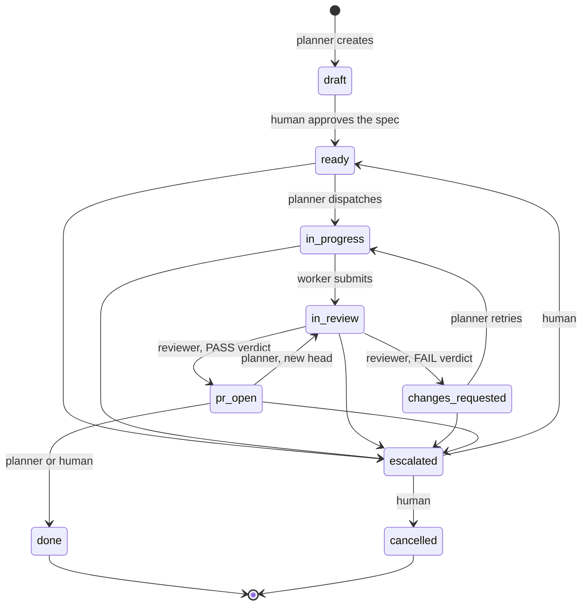

# agent-gates

[](https://github.com/MarcPaquet/agent-gates/actions/workflows/tests.yml)

Coding agents grade their own work, edit test assertions until they pass, and merge if nothing stops them. This kit
separates who plans, who builds and who reviews; makes the reviewer's verdict a file the state machine requires
before a task's pull request may be recorded as open; and keeps the three decisions that matter — spec, merge, escalation — behind gates
only a human at a real terminal can pass.

What each gate stops, and what it does not, is stated under [Honest limits](#honest-limits).

The core is plain Python 3.11 or later with no dependencies: a state machine (`gates/machine.py`), a JSON store
(`gates/store.py`), the agents' command line (`gates/cli.py`) and the human's command (`gates/approve.py`). It is
tool-agnostic. One harness adapter, for Claude Code, lives in [`.claude/`](.claude/README.md) and is live in this
repository.

## The loop



The five unlabelled arrows into `escalated` are made by the planner, the worker or the reviewer, with a reason,
what was tried, the options and a recommendation.

## Roles and the human's decisions

Each role is one screen of harness-neutral prose: the [planner](roles/planner.md) writes the spec and the contract
and moves the task, the [worker](roles/worker.md) builds inside the paths the task owns, and the
[reviewer](roles/reviewer.md) checks the work against the contract and writes the verdict. The human approves the
spec, resolves escalations and gives the go to merge a pull request at its head, with `gates/approve.py` at a
terminal. Who may do what, the human's commands and the merge go are in the
[reference](docs/reference.md#roles-and-the-humans-decisions).

## Try it

From a clone, with Python 3.11 or later and nothing to install, run these three commands at the repository root
against the committed store.

```
$ python gates/cli.py board
ID     STATE  OWNER   CYCLES  PR   TITLE
T-001  done   worker  1       #11  Markdown link checker (example app)
T-002  done   worker  1       #14  linkcheck: skip files that are not UTF-8, ...
```

```
$ python gates/cli.py history T-001
T-001  Markdown link checker (example app)
  2026-11-02T19:16:08Z  created -> draft                  planner   created
  2026-11-02T23:32:40Z  draft -> ready                    human     spec approved
  2026-11-03T15:48:00Z  ready -> in_progress              planner   dispatched to worker
  2026-11-03T16:00:13Z  in_progress -> in_review          worker    submitted for review
  2026-11-03T16:05:35Z  in_review -> changes_requested    reviewer  review failed: reviews/T-001-verdict-c1.md [verdict reviews/T-001-verdict-c1.md]
  2026-11-03T16:06:10Z  changes_requested -> in_progress  planner   dispatched again after a failed review
  2026-11-03T16:08:53Z  in_progress -> in_review          worker    submitted for review
  2026-11-03T16:14:46Z  in_review -> pr_open              reviewer  review passed: reviews/T-001-verdict-c2.md, pull request #11 [verdict reviews/T-001-verdict-c2.md, pr 11]
  2026-11-03T16:26:08Z  pr_open -> done                   human     merged in the GitHub UI without the merge-approval step
```

```
$ python gates/cli.py transition T-001 in_progress --actor worker
refused: T-001 is done, a terminal state, and no transition leaves it. If more work is needed, create a new task.
```

The third command exits with status 1 and leaves `gates.json` unchanged: `done` is terminal.

## The example runs

Two tasks ran through the gate in this repository. T-002 shows the whole loop as designed, with both human
commands; T-001 shows a merge that went around the merge go.

### T-002: the gate as designed

T-002 made the link checker skip and name a file that is not valid UTF-8 instead of crashing
([contract](contracts/T-002.md)). The [first verdict](reviews/T-002-verdict-c1.md) failed it: a checker that named
the skipped file wrongly still passed every test. The retry fixed the tests, and the
[second verdict](reviews/T-002-verdict-c2.md) passed, with 12 mutants each failing the test named for it. The human
gave the merge go with `approve.py T-002 --merge` at a terminal, and the agent merged pull request #14 at that head.

### T-001: a merge around the gate

T-001 built the [link checker](example/linkcheck/SPEC.md) itself through the gate. The
[first verdict](reviews/T-001-verdict-c1.md) failed it: its no-network test could not see a connection being
opened. The [second verdict](reviews/T-001-verdict-c2.md) passed. The human then merged pull request #11 in the
GitHub web interface without running `approve.py T-001 --merge` first, so `merge_approved_head` stayed empty; the
last line of `history T-001`, under [Try it](#try-it), records it.

Each step, and what each verdict found, is in
[the example runs, step by step](docs/reference.md#the-example-runs-step-by-step).

## Honest limits

- This kit is a rewrite of a workflow used by one developer on one private project since 2026-09. In this
  repository it has run two tasks, T-001 and T-002. There is no claim of adoption.
- Roles are self-declared: an agent passes `--actor`. They are separated by the harness's permission tiers and
  hooks, not by the library.
- Only the human is identity-checked, by an interactive terminal and an agent environment variable.
- The merge gate depends on the harness honouring hooks, and it binds only merges an agent runs. A merge in the
  GitHub web interface goes around the merge go, as T-001 shows; T-002 shows the go used. GitHub branch
  protection, or a required check that reads the store, could close that gap; neither is part of the kit.
- A process that writes the store without the library bypasses the lock.
- The store lives in the repository, so every task needs a follow-up pull request: the records written after a
  pull request opens (`pr_open`, the merge go, `done`) cannot be pushed to that pull request without sending the
  task back to review.

## Cut from the private version

The kit keeps the gates and leaves out the rest of the workflow it was rewritten from:

- Stories above tasks.
- A `blocked` state with aging.
- Counters of CI failures per task.
- A separate decision state with architecture decision records; here a decision is an escalation with a reason.
- Rules for screenshots of user-interface changes.
- Desktop notifications.
- A mirror of the board in another tool.

The roles table, the merge go, the state machine, the command line, the walls and the layout are in
[`docs/reference.md`](docs/reference.md).

## Running the tests

From the repository root:

```
python -m unittest discover -s gates/tests
python -m unittest discover -s example/linkcheck/tests
bash .claude/hooks/test-gate-guard.sh
```

GitHub Actions runs the same three on every pull request and every push to `main`, on Python 3.11, 3.12 and 3.13
([workflow](.github/workflows/tests.yml)). CI is not part of the state machine: no transition reads its result.

## License

MIT. See [LICENSE](LICENSE).
